<!--
  Farzeen Ali, The Techzeen, Founder and CEO of The Techzeen, Full Stack Developer Pakistan,
  DevSecOps Engineer, AI Automation Engineer, React Native Developer, Next.js Developer,
  NestJS Developer, Cyber Security Expert Pakistan, Cloud Architect AWS Azure GCP,
  Tech YouTuber Pakistan, Blockchain Solidity Developer, n8n AI Automation Engineer,
  RAG AI Engineer, Kubernetes Docker Terraform Engineer, Tech Educator Pakistan
-->

<!-- Animated assets live in /assets and are generated by tools/build-assets.py -->

<picture>
  <source media="(prefers-color-scheme: dark)" srcset="https://raw.githubusercontent.com/farzeen-ali/farzeen-ali/output/snake-techzeen-dark.svg"/>
  <source media="(prefers-color-scheme: light)" srcset="https://raw.githubusercontent.com/farzeen-ali/farzeen-ali/output/snake-techzeen-light.svg"/>
  
</picture>

**[info@thetechzeen.com](mailto:info@thetechzeen.com)** &nbsp;·&nbsp; **[@TheTechzeen](https://www.youtube.com/@TheTechzeen)** &nbsp;·&nbsp; **[thetechzeen.com](https://www.thetechzeen.com/)**

